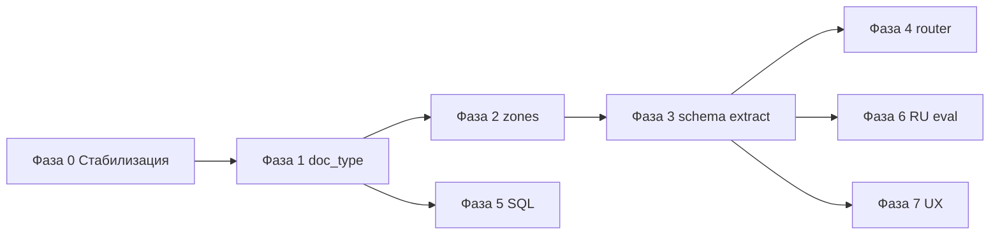

# Tabular DD — продакшн-роадмап (RU: аренда, поставка, услуги/подряд)

Цель: **таблица due diligence уровня Harvey** для российских договоров — без «костылей», с измеримым качеством и одним прод-путём.

Принципы:
- **Один canonical pipeline** для UI и eval (`run_tabular_cell_extraction`).
- **Schema-first** для типовых полей; **RAG** — fallback и свободные колонки; **SQL** — выписки/реестры; **multi-step/agent** — только аналитические колонки и чат.
- **Метрики по слоям**: recall (факт в контексте) ≠ extraction ≠ end-to-cell (gate).
- **N/A и needs_review** — нормальный исход при неоднозначности, не угадывание.

---

## Фаза 0 — Стабилизация базы (2–3 недели)

**Зачем:** сейчас eval и прод расходятся; часть качества «съедает» gate и размытые колонки.

| # | Работа | Критерий готовности |
|---|--------|---------------------|
| 0.1 | Smoke/eval только через `run_tabular_cell_extraction` (как UI) | `ru_*_tabular_smoke.py` вызывает тот же entrypoint |
| 0.2 | Удалить quote→answer из hot path (оставить флаг off, код — deprecated или feature-flag only) | Нет второго LLM на ячейку по умолчанию |
| 0.3 | Evidence gate: tolerant grounding (OCR пробелы, ИНН/суммы по digit-core) | INN-кейсы SS-KOB не forced_na при верном числе |
| 0.4 | Сохранение в run JSON: `context_chars`, chunk previews, `gold_in_context` | Регрессии диагностируются за 5 минут |
| 0.5 | CI: unit + tabular smoke на MAUD (EN) + RU mini-eval (пороги не регрессят) | PR блокируется при падении |

---

## Фаза 1 — Классификация документа на ingest (2 недели)

**Зачем:** аренда / поставка / услуги / подряд / ДС / приложение требуют разных полей и зон поиска.

| # | Работа | Критерий |
|---|--------|----------|
| 1.1 | Модель `File.doc_type` + `doc_type_confidence` + `doc_type_source` | Персистится после ingest |
| 1.2 | Классификатор: правила (имя, якоря) → LLM на первые 1.5–2k символов + outline title | `unknown` при confidence < порога |
| 1.3 | Таксономия v1: `lease_commercial`, `supply`, `services`, `works`, `addendum`, `appendix_spec`, `litigation`, `other` | Документирована в коде и в UI (опционально) |
| 1.4 | Gold-набор 30–50 PDF (10+ на тип) для accuracy классификатора | ≥90% на v1 gold |

**Не делаем:** 50 типов документов в первой итерации.

---

## Фаза 2 — Document zones (3–4 недели)

**Зачем:** текст + таблицы с линиями + псевдо-таблицы (реквизиты) нельзя искать одним retrieval.

| # | Работа | Критерий |
|---|--------|----------|
| 2.1 | Расширить ingest metadata: `zone` на chunk (`preamble`, `body`, `table`, `requisites`, `signature`) | Chunks в PGVector несут zone |
| 2.2 | Heuristics + Docling labels: таблицы, блок реквизитов (ИНН/КПП/р/с), приложения | Ручная проверка на 20 договорах |
| 2.3 | **Column → preferred zones** в `column_config` | Retrieval фильтрует/бустит зоны |
| 2.4 | Short doc policy: если `len(original_text) < N` → full text в контекст ячейки | Нет лишнего chunk noise на 5–15 стр. |

---

## Фаза 3 — Contract extraction layer (4–6 недель)

**Зачем:** простые колонки («срок», «неустойка», «предмет») стабильнее из JSON, чем из ad-hoc RAG.

| # | Работа | Критерий |
|---|--------|----------|
| 3.1 | Pydantic-схемы: `LeaseExtraction`, `SupplyExtraction`, `ServicesWorksExtraction` | Версия схемы в JSON на файле |
| 3.2 | Запуск на ingest (async) или lazy при первом открытии таблицы | `file.contract_facts` / отдельная таблица |
| 3.3 | Один LLM-pass по секциям (outline-aware), не 40 вызовов на файл | Latency ingest приемлемая (SLA документирован) |
| 3.4 | Маппинг **шаблонов колонок** → поля схемы (`column.field_id`) | Юрист выбирает шаблон «Аренда РФ», не пишет размытый prompt |
| 3.5 | Tabular cell: если `field_id` заполнен из schema → **без RAG**; иначе hybrid RAG | Метрика: % ячеек schema vs rag |

**Не делаем:** отдельный агент на каждую ячейку для полей схемы.

---

## Фаза 4 — Маршрутизатор сложности вопроса (2 недели)

**Зачем:** «дата документа» и «перечисли риски» — разная стоимость и логика.

| # | Работа | Критерий |
|---|--------|----------|
| 4.1 | `ColumnKind`: `fact`, `verbatim`, `summary`, `risk_analysis`, `manual` | Хранится на колонке |
| 4.2 | `fact` → schema / light RAG; `risk_analysis` → multi-step graph (фиксированный, не свободный agent) | Лимит шагов и токенов на ячейку |
| 4.3 | Чат по делу: agentic RAG разрешён; tabular — только для `risk_analysis` колонок | Продуктовое правило в config |

Multi-step (не костыль): **Plan → retrieve sections (liability, termination, SLA) → synthesize list + citations** — LangGraph с 3–4 узлами, тестируемый.

---

## Фаза 5 — Выписки и реестры (параллельно, 2 недели)

**Зачем:** уже есть SQL router; нужно жёстко не пускать statement в абзацный RAG для сумм.

| # | Работа | Критерий |
|---|--------|----------|
| 5.1 | Ingest probe: statement/register → structured rows 100% | Tabular currency columns на выписке идут в SQL plane |
| 5.2 | UI: индикатор «данные из таблицы операций» vs «из текста договора» | Прозрачность для юриста |

---

## Фаза 6 — RU eval как контракт качества (ongoing)

| Набор | Назначение | Размер (цель) |
|-------|------------|---------------|
| `evals/ru_lease/` | коммерческая аренда | 20–30 договоров, 15 колонок |
| `evals/ru_supply/` | поставка | 20–30 |
| `evals/ru_services/` | услуги/IT | 15–20 |
| `evals/ru_ss_kob` | регрессия mixed (уже есть) | поддерживать |
| MAUD 10×10 | EN регрессия retrieval | CI |

Метрики в отчёте:
- **recall@k** (gold substring in merged context)
- **cell accuracy** (matcher)
- **forced_na rate**
- **schema hit rate**

---

## Фаза 7 — UX прод (2–3 недели)

| # | Работа |
|---|--------|
| 7.1 | Cell: reasoning + подсветка цитаты (как Harvey) — довести viewer |
| 7.2 | Re-run cell / column; conditional columns `@Col` |
| 7.3 | Table instructions (глобальный prompt таблицы) |
| 7.4 | Export Excel/CSV с source refs |

---

## Порядок внедрения (рекомендуемый)

**Первый пользовательский win:** Фаза 0 + 1 + шаблоны колонок «Аренда РФ» (часть 3.4) на schema-lite (front matter + ключевые поля) до полного 3.2.

---

## Явно не делаем (anti-patterns)

- CLaRa / HSA как замена schema (только R&D watchlist).
- Второй LLM на каждую ячейку (quote→answer).
- Одна универсальная колонка «сумма/договор» на все типы документов.
- Agentic loop на все 40 ячеек таблицы.
- Оценка качества только по «accuracy без разбивки recall/gate».

---

## Команда и владение

| Area | Owner (роль) |
|------|----------------|
| Ingest + zones + doc_type | Backend ingest |
| Schema + tabular mapping | Backend tabular |
| Eval + CI | Platform / QA |
| Templates + UX | Product + Frontend |
| Legal gold | Юрист + PM |

---

## Definition of Done для «прод таблицы v1»

1. Классификатор договоров (аренда/поставка/услуги) на ingest.
2. Шаблоны колонок по типу; ≥70% **fact** колонок на RU gold через schema+RAG без регрессии MAUD.
3. Один pipeline UI = eval; CI green.
4. Risk-колонка: multi-step с цитатами, лимит latency документирован.
5. Выписки: SQL plane для денежных полей.

---

*Документ версии 1.0 — после коммита `Tabular DD: context pipeline, RU eval harnesses`.*
